# ERD Pondok

> Sumber: diskusi desain Pondok (pondok.org), Oktober 2026. Diagram Mermaid tampil langsung di GitHub. Kolom `created_at`/`updated_at` ada di semua tabel dan tidak ditulis di diagram.

Skema database untuk modul di PRD: Akademik & Santri, Asrama, Tahfidz, Perizinan, Dokumen, Prestasi, PSB, Keuangan, Konten Publik, dan Pengguna & RBAC. Nama tabel memakai bahasa Inggris agar sesuai konvensi Eloquent; istilah domain dijelaskan di kolom komentar.

## Ringkasan relasi antar modul

Pusatnya adalah `students`. Jenjang (SD/SLTP/SLTA) disimpan di satu tabel `units`, dan semua data siswa ada dalam satu tabel dengan `unit_id`. Ini menjawab pertanyaan di PRD bagian 3: tabel terpusat, bukan skema terpisah per jenjang.

Notasi relasi:

- `||--o{` satu ke banyak
- `|o--o|` satu ke nol/satu
- `}o--o{` banyak ke banyak (pivot)

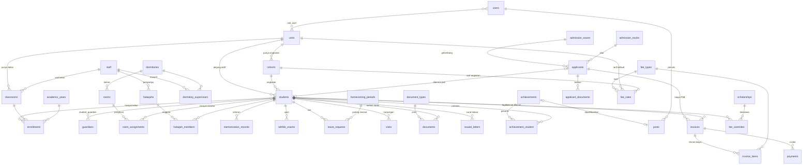

## Akademik & Santri

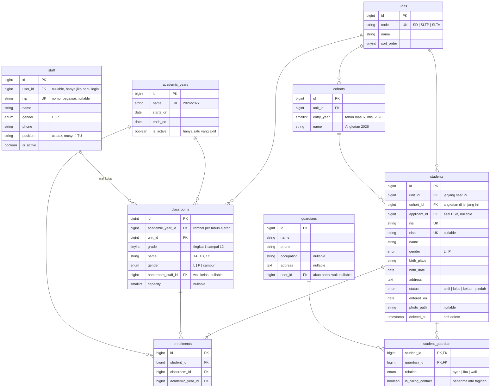

- **Kelas paralel:** 1A, 1B, 1C adalah tiga baris `classrooms` dengan `grade = 1` dan `name` berbeda. Laporan "seluruh kelas 1" cukup dengan filter `grade`.
- `classrooms` dibuat per tahun ajaran (rombel), karena wali kelas, jumlah paralel, dan pembagian putra/putri bisa berubah tiap tahun. Kelas tahun lalu tetap utuh untuk arsip. Panel admin bisa menyalin daftar kelas dari tahun sebelumnya.
- `staff` menampung ustadz, wali kelas, dan musyrif. Tidak semua perlu login, jadi `user_id` boleh kosong.
- `enrollments` menyimpan riwayat kelas per tahun ajaran, jadi kenaikan kelas tidak menimpa data lama.
- Saat santri lanjut dari SD ke SLTP, `unit_id` dan `cohort_id` di `students` diperbarui ke jenjang baru. Riwayatnya tetap terbaca dari `enrollments` dan snapshot di `invoices`.
- `students.unit_id` sengaja diduplikasi dari `cohorts.unit_id` supaya filter dan scope per jenjang cepat. Validasi kecocokannya di Action class.
- Wali memakai pivot karena kakak-adik di pondok sering berbagi wali yang sama, sehingga tagihan bisa digabung per keluarga.

## Asrama & Musyrif

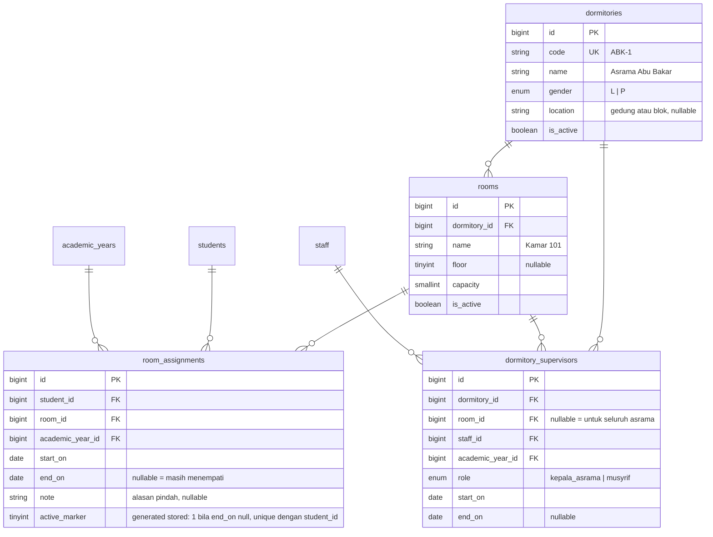

- **Santri di asrama mana:** baris `room_assignments` dengan `end_on` kosong. Asramanya dibaca lewat `rooms.dormitory_id`. Pindah kamar di tengah tahun cukup menutup baris lama dan membuat baris baru, sehingga riwayatnya tersimpan.
- **Musyrifnya siapa:** `dormitory_supervisors` bisa per asrama (`room_id` kosong) atau per kamar. Jadi pola "satu musyrif per asrama" dan "satu musyrif per kamar" sama-sama didukung, dan pergantian musyrif tercatat.
- Santri yang tidak punya penempatan aktif adalah santri nonmukim (pulang-pergi), tanpa kolom tambahan.
- `dormitories.gender` dicocokkan dengan `students.gender` saat penempatan, dan `rooms.capacity` dicek di Action `AssignRoom`.

## Tahfidz

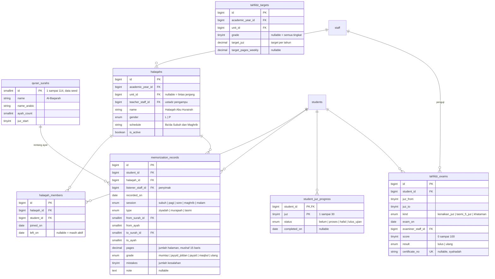

- **Setoran harian** dicatat sebagai rentang surah dan ayat, bukan teks bebas. Dengan begitu total halaman, capaian juz, dan grafik kemajuan bisa dihitung otomatis. `quran_surahs` adalah data tetap yang diisi saat instalasi.
- **Ziyadah, murajaah, dan tasmi'** dibedakan lewat `type`. Laporan ke wali bisa menampilkan hafalan baru dan pengulangan secara terpisah.
- `student_juz_progress` adalah ringkasan per juz yang diperbarui setiap ada setoran atau ujian, supaya dashboard dan portal wali tidak perlu menghitung ulang dari seluruh riwayat setoran.
- `tahfidz_targets` membandingkan capaian dengan target per jenjang dan tingkat, sehingga santri yang tertinggal bisa terlihat lebih awal.
- Anggota halaqah punya riwayat, jadi santri yang pindah halaqah tetap terlacak pengampunya di setiap periode.
- `pages` mengacu pada mushaf standar 15 baris. Kalau pondok memakai standar lain, cukup diatur di `settings`.

## Perizinan, Kepulangan & Kunjungan

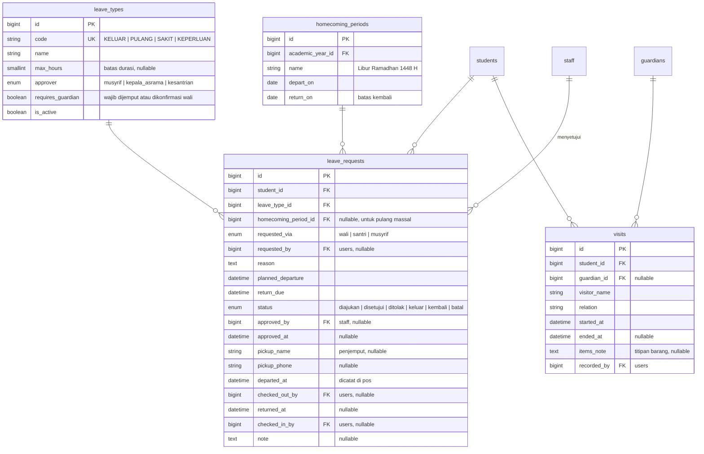

- **Alur izin:** wali atau musyrif mengajukan, lalu disetujui oleh pihak sesuai `leave_types.approver`. Petugas pos mencatat jam keluar dan kembali. Persetujuan otomatis diarahkan ke musyrif kamar atau asrama santri lewat `dormitory_supervisors`, tanpa perlu memilih manual.
- **Terlambat kembali** tidak disimpan sebagai status. Cukup dibandingkan `returned_at` dengan `return_due`, atau santri yang belum kembali padahal sudah lewat batas. Daftar ini bisa langsung tampil di dashboard kesantrian.
- **Pulang massal** (libur semester, Ramadhan): buat satu `homecoming_periods`, lalu sistem membuat izin untuk semua santri mukim sekaligus. Petugas cukup mencatat keluar dan kembali, dan rekap santri yang belum kembali tersedia per asrama.
- **Notifikasi WA ke wali** dikirim saat izin disetujui, saat santri keluar dari pos, dan saat kembali.
- `visits` mencatat kunjungan wali (sambangan) beserta titipan barang, berguna untuk keamanan dan menjawab pertanyaan wali.

## Dokumen

Sebelumnya dokumen hanya ada di PSB (`applicant_documents`). Sekarang ada satu tabel dokumen umum untuk santri, wali, staff, dan prestasi, serta catatan surat yang dikeluarkan pondok.

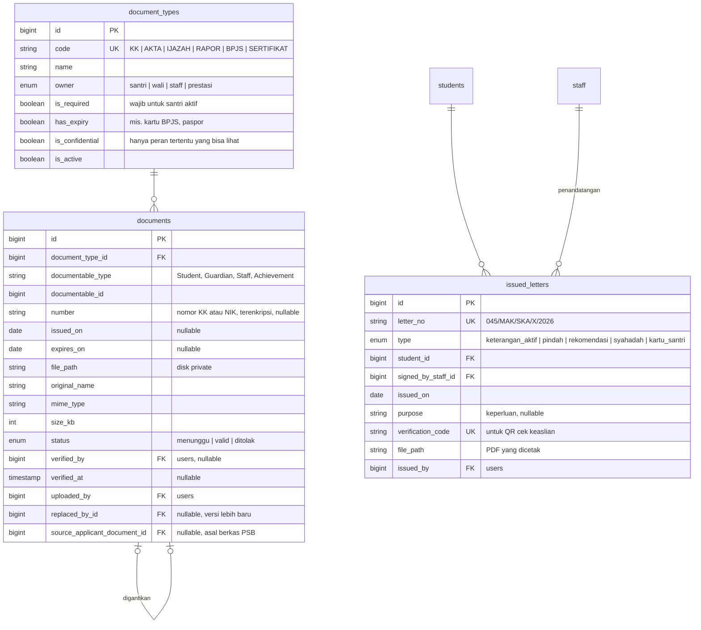

- **Satu tabel untuk semua pemilik** lewat relasi polymorphic Laravel (`documentable`). Fitur unggah, verifikasi, dan penyimpanan cukup dibuat sekali.
- **Berkas PSB tidak perlu diunggah ulang.** `admission_requirements` kini merujuk ke `document_types`. Saat pendaftar menjadi santri, berkas yang sudah valid disalin menjadi `documents` milik santri.
- **Kelengkapan berkas** bisa dicek otomatis: jenis dokumen yang `is_required` tapi belum ada atau belum valid. Hasilnya bisa tampil sebagai widget di dashboard dan sebagai pengingat di portal wali.
- **Riwayat versi:** dokumen yang diperbarui (misalnya KK baru) tidak menimpa yang lama. Dokumen lama ditandai lewat `replaced_by_id`.
- **Data pribadi:** nomor KK dan NIK disimpan dengan cast `encrypted` Laravel. File tersimpan di disk private dan dokumen `is_confidential` hanya bisa dibuka peran yang punya permission khusus. Ini sejalan dengan kewajiban perlindungan data di UU PDP.
- **Surat keluar** (keterangan aktif, rekomendasi, pindah, syahadah) diberi nomor otomatis dan kode verifikasi. Pihak luar bisa memindai QR untuk mengecek keasliannya.

## Prestasi Santri

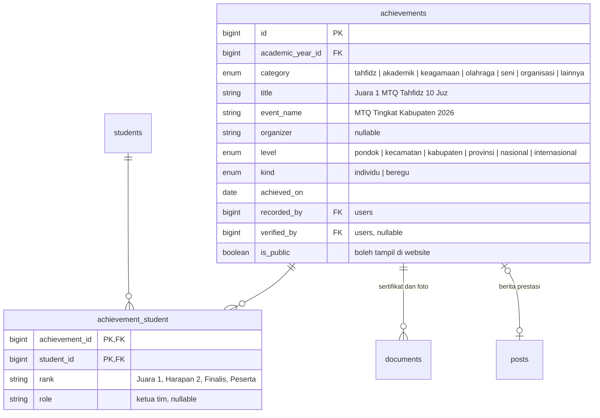

- **Prestasi tercatat di profil santri,** tidak hanya sebagai berita di website. Rekap per santri, per kategori, dan per tingkat bisa ditampilkan di rapor, portal wali, dan surat rekomendasi.
- **Prestasi beregu** cukup dicatat sekali lalu dihubungkan ke semua santri anggotanya lewat `achievement_student`, masing-masing dengan peringkat dan perannya.
- **Sertifikat dan foto** disimpan di tabel `documents` dengan pemilik `Achievement`.
- **Publikasi ke website:** prestasi dengan `is_public` bisa diterbitkan menjadi berita lewat `posts.achievement_id`. Data prestasi tetap satu sumber, dan widget prestasi di dashboard serta halaman publik mengambil dari tabel yang sama.
- Kelulusan ujian khataman di modul tahfidz bisa otomatis diusulkan sebagai prestasi kategori tahfidz tingkat pondok.
- Nanti, modul kedisiplinan bisa memakai prestasi ini sebagai poin positif yang mengimbangi poin pelanggaran.

## Penerimaan Santri Baru (PSB)

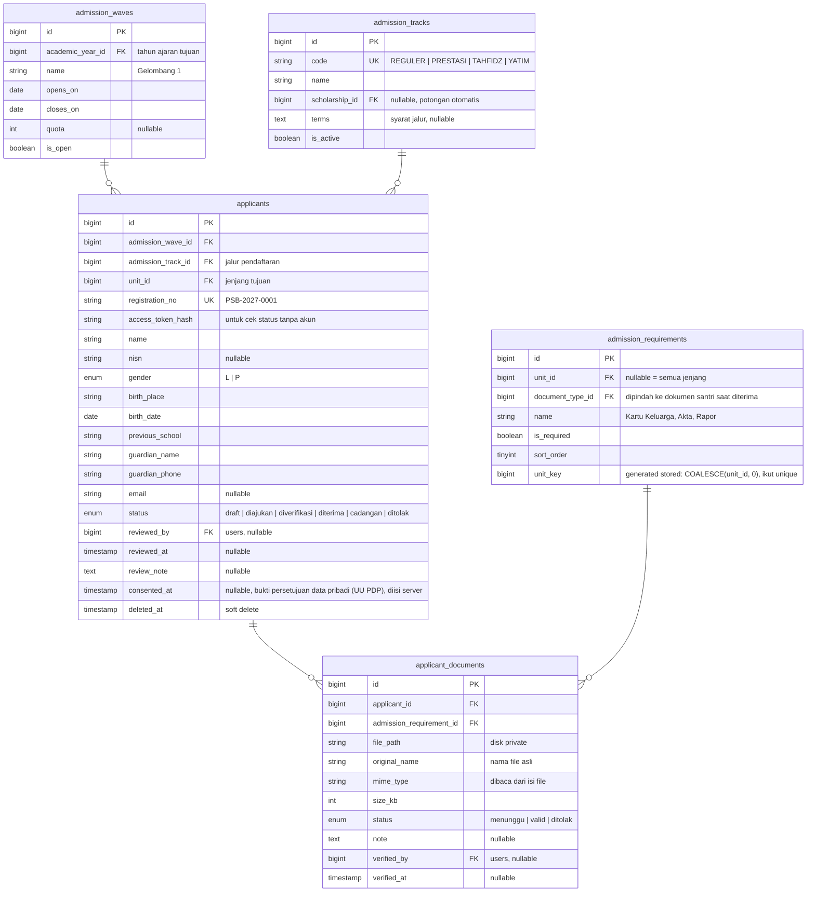

- Pendaftar tidak perlu akun di tabel `users`. Mereka cek status dan unggah ulang berkas dengan nomor pendaftaran + token (disimpan dalam bentuk hash).
- Saat status menjadi *diterima*, sebuah Action membuat baris `students` dengan `applicant_id` terisi dan menyalin data wali ke `guardians`.
- Berkas disimpan di disk `private` (bukan `public`) dan diakses lewat route yang dicek permission-nya, karena berisi KK dan akta.
- **Token akses:** 12 karakter dari alfabet tanpa huruf/angka yang mirip (`A-H J-N P-Z 2-9`), ditampilkan `XXXX-XXXX-XXXX`; yang disimpan hanya hash dari token ternormalisasi (huruf besar, tanpa spasi/tanda hubung). Token bisa diatur ulang panitia.
- **Kuota gelombang** dihitung dari pendaftar semua jenjang, tanpa status `draft` dan tanpa pendaftar terhapus (soft delete).
- **FK `applicant_id`** di `students`, `fee_overrides`, dan `invoices` kini dibuat (`restrictOnDelete`) setelah tabel `applicants` ada.

### Biaya PSB

Biaya PSB memakai mekanisme yang sama dengan SPP: jenis biaya, tarif yang berlaku per tahun ajaran, potongan, dan tagihan gabungan atau terpisah. Bedanya, tagihan dibuat untuk pendaftar (`applicant_id`) karena mereka belum menjadi santri.

| Tahap | Yang terjadi | Tagihan |
| --- | --- | --- |
| Daftar online | Status *diajukan* | Biaya formulir dibuat otomatis dari jenis biaya `saat_daftar`. Tarif bisa dibedakan per gelombang dan jenjang. |
| Formulir lunas | Unggah berkas dan jadwal tes dibuka | Lunas ditandai lewat pembayaran yang dicatat bendahara (`RecordPayment`), bukan oleh panitia. |
| Diterima | Status *diterima* | Uang pangkal, seragam, kitab dibuat dari jenis biaya `saat_diterima`. Potongan jalur diterapkan otomatis, dan pembayaran bisa dicicil. |
| Daftar ulang | Data santri dibuat | Tagihan dan keringanan yang belum selesai ikut pindah ke santri. Tagihan bulanan dimulai bulan berikutnya. |

- **Tarif per gelombang:** `fee_rates.admission_wave_id` memungkinkan gelombang 1 lebih murah dari gelombang 2. Kalau kosong, tarif berlaku untuk semua gelombang. Kolom biaya di `admission_waves` dihapus agar semua tarif ada di satu tempat.
- **Berubah tiap tahun atau tetap:** sama seperti SPP, lewat `effective_from_year_id`.
- **Jalur pendaftaran:** `admission_tracks` seperti Tahfidz atau Yatim bisa dihubungkan ke program beasiswa. Saat pendaftar jalur itu diterima, keringanannya dibuat otomatis, misalnya uang pangkal gratis atau SPP potong 50%.
- **Keringanan khusus:** panitia bisa memberi potongan per pendaftar (misalnya diskon saudara kandung) lewat `fee_overrides.applicant_id`, termasuk potongan SPP yang mulai berlaku setelah jadi santri.
- **Pindah ke santri:** saat santri dibuat, `student_id` diisi pada tagihan dan keringanan milik pendaftar. `applicant_id` tetap disimpan, jadi tunggakan uang pangkal terlihat di profil santri dan asalnya tetap terlacak.
- **Pemisahan `billing_group`:** satu kelompok tagihan hanya boleh berisi jenis biaya dari kelas frekuensi yang sama: `saat_daftar`, `saat_diterima`, atau lainnya (`bulanan`, `tahunan`, `manual`). Tagihan formulir tidak menghalangi tagihan saat diterima, dan setelah konversi tidak bertabrakan dengan generator bulanan.
- Syarat minimal pembayaran untuk daftar ulang (misalnya lunas atau minimal 50%) diatur di `settings` sebagai `psb.min_paid_percent`.

## Keuangan & Tagihan

SPP, asrama, makan, dan biaya lain diperlakukan sebagai *jenis biaya*. Apakah semuanya digabung dalam satu tagihan atau dipisah ditentukan oleh `fee_types.billing_group`, dan bisa diatur dari panel admin tanpa ubah kode.

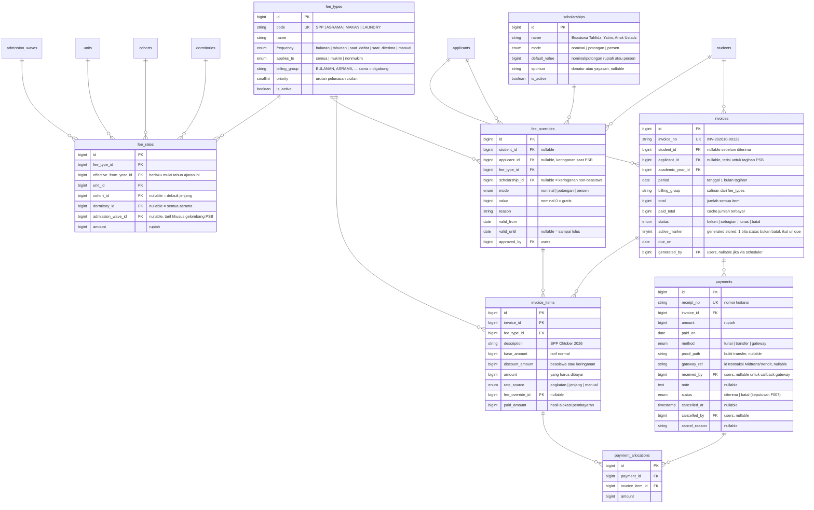

| Mode | Pengaturan `billing_group` | Hasil per santri mukim per bulan |
| --- | --- | --- |
| Digabung | SPP, ASRAMA, MAKAN semuanya `BULANAN` | 1 tagihan berisi 3 item |
| Dipisah | SPP → `SPP`, ASRAMA dan MAKAN → `ASRAMA` | 2 tagihan: SPP dan Asrama |
| Dipisah penuh | Setiap jenis punya grup sendiri | 3 tagihan terpisah |

- Santri nonmukim otomatis tidak ditagih biaya dengan `applies_to = mukim`. Status mukim dibaca dari `room_assignments` yang aktif.
- `fee_rates.dormitory_id` memungkinkan tarif asrama berbeda per gedung, misalnya asrama baru lebih mahal. Kalau tidak dipakai, biarkan kosong.
- **Tarif berubah atau tetap:** `fee_rates` berlaku mulai tahun ajaran tertentu sampai ada baris yang lebih baru. Kalau SPP tidak berubah, cukup satu baris dan tidak perlu disalin tiap tahun. Kalau naik, tambahkan baris baru dengan tahun ajaran berikutnya, dan tarif lama tetap tersimpan sebagai riwayat.
- **Tarif dikunci per angkatan:** isi `cohort_id`. Contoh: angkatan 2025 tetap Rp500.000 sampai lulus, sementara angkatan 2026 membayar Rp600.000. Tarif angkatan selalu menang atas default jenjang.
- **Beasiswa dan keringanan:** `fee_overrides` per santri, per jenis biaya, dengan masa berlaku. Tiga mode: *nominal* (bayar Rp250.000, atau Rp0 untuk gratis), *potongan* (dikurangi Rp100.000), dan *persen* (dikurangi 50%). Mode potongan dan persen ikut menyesuaikan saat tarif normal naik.
- `scholarships` mengelompokkan program beasiswa, sehingga bendahara bisa melaporkan total subsidi per program atau per donatur. Keringanan yang bukan beasiswa (misalnya kesepakatan dengan wali) cukup tanpa `scholarship_id`.
- `invoice_items` menyimpan tarif normal, potongan, dan nominal akhir, jadi besarnya beasiswa yang diberikan tiap bulan bisa dihitung langsung dari tagihan.
- Pembayaran cicilan pada tagihan gabungan dialokasikan ke item sesuai `fee_types.priority` (misalnya makan dulu, lalu asrama, lalu SPP) dan dicatat di `payment_allocations`. Laporan bendahara per jenis biaya jadi akurat.
- Pembayaran tidak dihapus. Pembayaran salah input dibatalkan (`payments.status = batal`, beserta `cancelled_at`, `cancelled_by`, `cancel_reason`); baris, nomor kuitansi, alokasi, dan bukti transfer tetap ada, sedangkan `paid_amount` item dan `paid_total` tagihan dikurangi kembali. Alokasi berlaku selama pembayarannya `diterima`; pembayaran lain tidak dialokasikan ulang (keputusan F007).
- Nomor kuitansi `KW-YYYYMM-NNNNN`, urut per bulan pencatatan untuk semua jenjang; pembayaran `batal` tetap memakai nomornya. Bukti transfer disimpan di disk `private`.
- Biaya `saat_daftar` dan `saat_diterima` (formulir, uang pangkal, seragam, kitab) tidak dibuat oleh generator bulanan, tetapi oleh alur PSB. Lihat bagian [PSB](#psb).
- Semua nominal uang memakai `bigint` rupiah tanpa desimal, dan nominal item adalah snapshot sehingga perubahan tarif tidak mengubah tagihan lama.

## Konten Publik (CMS)

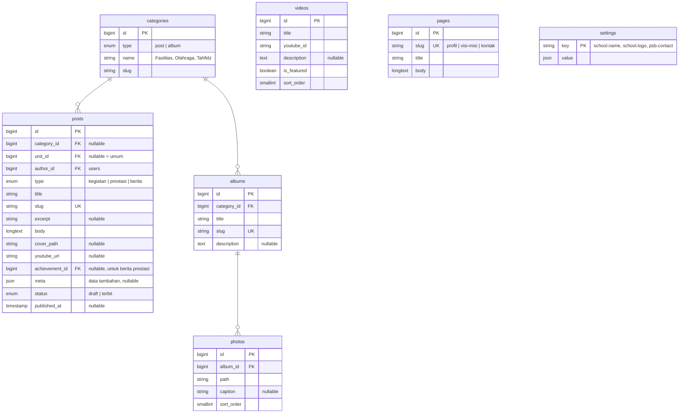

- Kegiatan, prestasi, dan berita disatukan di `posts` dengan kolom `type`. Berita prestasi merujuk ke `achievements` lewat `achievement_id`, jadi data tingkat, peringkat, dan santri yang terlibat tidak ditulis ulang.
- `settings` menyimpan profil sekolah sebagai key-value, sehingga instalasi baru cukup mengisi lewat panel tanpa ubah kode.

## Pengguna & RBAC

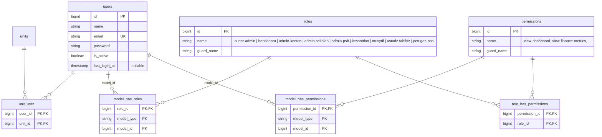

- Tabel `roles`, `permissions`, dan tiga pivotnya dibuat oleh migration Spatie Permission. Tidak perlu ditulis sendiri.
- `unit_user` mengatur cakupan jenjang. Contohnya admin-sekolah yang hanya mengurus SLTP. Jika user tidak punya baris di sini, artinya ia boleh melihat semua jenjang. Diterapkan lewat global scope pada model `Student`, `Invoice`, dan `Applicant`.
- Permission menentukan *modul apa* yang boleh diakses, sedangkan `unit_user` menentukan *data jenjang mana*. Dua hal ini sengaja dipisah.

## Aturan tarif & constraint penting

### Urutan penentuan nominal per jenis biaya

Dijalankan oleh `GenerateMonthlyInvoices` lewat scheduler setiap tanggal 1. Untuk setiap jenis biaya bulanan yang berlaku bagi santri, tarif normal dicari dari yang paling spesifik: angkatan + asrama, angkatan, jenjang + asrama, lalu jenjang. Dari kandidat itu dipilih baris dengan `effective_from_year` terbaru yang sudah berlaku.

Setelah itu, override yang aktif di bulan tagihan diterapkan. Santri yang dibebaskan tetap mendapat item Rp0 beserta alasannya.

```php
foreach (students aktif as $s) {
  $dorm = $s->activeRoom?->dormitory_id;   // null = nonmukim

  foreach (feeTypes bulanan berlaku untuk $s as $fee) {
    $base = rate($fee, $s, $dorm, $tahunAjaran); // tarif terbaru
    $ovr  = override($s, $fee, $bulan);          // beasiswa aktif

    if ($base === null && $ovr?->mode !== 'nominal') {
      log('tarif belum diatur'); continue;
    }

    $amount = match ($ovr?->mode) {
      'nominal'  => min($ovr->value, $base ?? $ovr->value), // tidak pernah di atas tarif
      'potongan' => max(0, $base - $ovr->value),
      'persen'   => $base - intdiv($base * $ovr->value, 100),
      default    => $base,
    };

    $inv = Invoice::firstOrCreate([
      'student_id'    => $s->id,
      'period'        => $bulan,
      'billing_group' => $fee->billing_group,
    ]);
    $inv->items()->firstOrCreate(
      ['fee_type_id' => $fee->id],
      ['base_amount' => $base, 'amount' => $amount, ...]
    );
  }
  // hitung ulang invoices.total
}
```

| Tabel | Constraint / index | Alasan |
| --- | --- | --- |
| `invoices` | generated column stored `active_marker = CASE WHEN status <> 'batal' THEN 1 END`; unique (`student_id`, `period`, `billing_group`, `active_marker`) | Generator aman dijalankan ulang tanpa membuat tagihan ganda. Hanya satu tagihan aktif per kombinasi; tagihan `batal` bernilai NULL sehingga boleh banyak dan tidak menghalangi tagihan pengganti (keputusan F006) |
| `invoices` | check: `student_id` atau `applicant_id` wajib terisi; unique (`applicant_id`, `billing_group`, `active_marker`) | Tagihan selalu punya pemilik, dan biaya PSB tidak dobel selama tagihannya aktif |
| `invoice_items` | unique (`invoice_id`, `fee_type_id`) | Satu jenis biaya hanya muncul sekali per tagihan |
| `payments` | unique `receipt_no`; index (`invoice_id`, `status`), (`status`, `paid_on`); semua FK `restrictOnDelete` | Nomor kuitansi tidak ganda; daftar pembayaran per tagihan dan laporan kas harian (F008) |
| `payment_allocations` | unique (`payment_id`, `invoice_item_id`); FK `restrictOnDelete` | Satu baris alokasi per item per pembayaran |
| `fee_overrides` | index (`student_id`, `fee_type_id`, `valid_from`) | Cari override yang berlaku di bulan tagihan |
| `invoices` | index (`status`, `period`) | Widget tunggakan dan rasio koleksi di dashboard |
| `fee_rates` | unique (`fee_type_id`, `effective_from_year_id`, `unit_id`, `cohort_key`, `dormitory_key`, `wave_key`) | Satu tarif per kombinasi. Lihat catatan NULL di bawah |
| `enrollments` | unique (`student_id`, `academic_year_id`) | Satu kelas per santri per tahun ajaran |
| `students` | unique `nis`; index (`unit_id`, `status`) | Hitungan santri aktif per jenjang |
| `cohorts` | unique (`unit_id`, `entry_year`) | Tidak ada angkatan ganda dalam satu jenjang |
| `classrooms` | unique (`academic_year_id`, `unit_id`, `name`) | 1A hanya ada satu per jenjang per tahun ajaran |
| `room_assignments` | index (`student_id`, `end_on`), (`room_id`, `end_on`) | Cari kamar aktif santri dan hitung sisa kapasitas kamar |
| `room_assignments` | generated column stored `active_marker = CASE WHEN end_on IS NULL THEN 1 END`; unique (`student_id`, `active_marker`) | Satu penempatan aktif per santri. Baris riwayat bernilai NULL sehingga tidak saling bentrok (pola sama dengan catatan NULL di bawah) |
| `rooms` | unique (`dormitory_id`, `name`) | Nama kamar unik per asrama |
| `memorization_records` | index (`student_id`, `recorded_on`), (`halaqah_id`, `recorded_on`) | Riwayat setoran per santri dan rekap harian per halaqah |
| `halaqah_members` | index (`student_id`, `left_on`) | Cari halaqah aktif santri |
| `leave_requests` | index (`status`, `return_due`), (`student_id`, `status`) | Daftar santri yang sedang di luar dan yang terlambat kembali |
| `leave_requests` | unique (`student_id`, `homecoming_period_id`) | Satu izin pulang massal per santri per periode |
| `documents` | index (`documentable_type`, `documentable_id`, `document_type_id`), (`expires_on`) | Cek kelengkapan berkas dan dokumen yang akan kedaluwarsa |
| `achievements` | index (`academic_year_id`, `category`, `level`) | Rekap prestasi per tahun, kategori, dan tingkat |
| `applicant_documents` | unique (`applicant_id`, `admission_requirement_id`) | Unggah ulang menimpa berkas lama, tidak menumpuk |
| `admission_waves` | unique (`academic_year_id`, `name`) | Nama gelombang tidak ganda dalam satu tahun ajaran (keputusan F009). Rentang tanggal gelombang dalam satu tahun ajaran juga tidak beririsan, dijaga Action `SaveAdmissionWave` |
| `admission_requirements` | generated column stored `unit_key = COALESCE(unit_id, 0)`; unique (`document_type_id`, `unit_key`) | Satu syarat per jenis dokumen per jenjang (keputusan F009). Syarat semua jenjang dan syarat per jenjang untuk jenis yang sama tidak boleh berdampingan (dijaga Action). Keterbatasan: satu jenis dokumen hanya bisa jadi satu syarat per jenjang, jadi dua syarat bertipe sama (mis. rapor semester 1 dan 2) belum bisa dimodelkan; F012 memetakan berkas valid ke `documents` dengan asumsi satu jenis ke satu syarat. Melonggarkannya nanti adalah perubahan skema |
| `applicants` | index (`admission_wave_id`, `status`), (`created_at`) | Breakdown status dan pendaftar 7 hari terakhir |

### Catatan NULL pada unique key

MySQL dan Postgres menganggap setiap `NULL` berbeda, jadi unique key biasa di `fee_rates` tetap membolehkan dua tarif default jenjang untuk jenis biaya dan tahun yang sama. Solusinya, tambahkan generated column `cohort_key = COALESCE(cohort_id, 0)` `dormitory_key = COALESCE(dormitory_id, 0)`, dan `wave_key = COALESCE(admission_wave_id, 0)`, lalu pasang unique di kolom itu. Cara ini jalan di MySQL, MariaDB, Postgres, dan SQLite.

### Tabel bawaan yang tidak digambar

- `sessions`, `cache`, `password_reset_tokens`
- `jobs`, `job_batches`, `failed_jobs` (queue driver database)
- `notifications` (notifikasi in-app Filament)
- `activity_log` dari Spatie Activitylog untuk audit `invoices`, `payments`, dan perubahan override

### Konvensi umum

- Semua tabel memakai `created_at` dan `updated_at` (tidak ditulis di diagram).
- Soft delete hanya untuk `students`, `applicants`, dan `posts`. Data keuangan tidak dihapus, cukup diberi status *batal*.
- Foreign key ke data keuangan memakai `restrictOnDelete`, bukan cascade.
